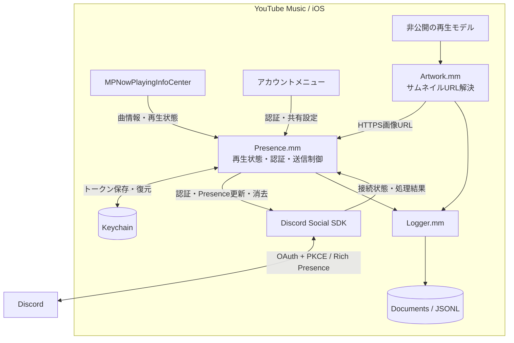

# YTMusic iOS DiscordRPC

iOS版YouTube Musicの再生情報を、注入したObjective-C++ dylibからDiscord Social SDK経由でRich Presenceへ送信します。

## Features

- `MPNowPlayingInfoCenter`から曲名・アーティスト・アルバム・再生時刻を取得。送信間隔は最低15秒で、一時停止・停止時にPresenceを消去。
- OAuth + PKCEで認証し、アクセストークンとリフレッシュトークンをKeychainに保存。
- 再生モデルから曲のサムネイルURLを取得。画像を含む送信が拒否された場合は画像なしで再試行。
- 認証・接続・送信結果をJSON Lines形式で記録し、認証情報の伏せ字とログローテーションに対応。
- PythonでMach-Oのロード命令を追加し、既存dylibのSHA-256とZIPのCRCを検証して未署名IPAを生成。

## Requirements

| 対象 | 要件 |
| --- | --- |
| ビルド環境 | macOS、Xcode、iPhoneOS SDK、`xcrun` |
| 言語 | Objective-C / Objective-C++、C++20、Python 3.10以上 |
| Discord SDK | 公式`discord_partner_sdk.xcframework`のiOS実機arm64スライス |
| 入力IPA | Bundle IDが`com.google.ios.youtubemusic`、実行ファイルが非暗号化のthin arm64 |
| 実行環境 | iOS 16.0以上、全ネストコードを再署名できる署名・インストール環境 |
| Discord認証 | Social SDKを利用できるApplication ID、Public Client設定、OAuthリダイレクトURI |

- 既存の検証記録ではYouTube Music **9.26.2**とDiscord Social SDK **1.10.19337**を使用。
- Pythonツールは標準ライブラリのみを使用。
- YouTube Music本体、Discord SDK、署名用証明書は同梱しません。
- Windowsでは`tools/build.py`によるコンパイルは実行できません。

## Installation

以下はリポジトリのルートで実行します。

1. 公式SDKを`work/input/discord_partner_sdk.xcframework`へ配置。
2. 入力IPAを`work/input/YouTubeMusic_9.26.2.ipa`へ配置。
3. `config.json`の`application_id`を使用するDiscordアプリに合わせて変更。
4. DiscordアプリでPublic Clientを有効にし、`discord-<application_id>:/authorize/callback`をリダイレクトURIとして登録。

初期設定：

```json
{
  "application_id": "1559887091171852310",
  "minimum_ios": "16.0",
  "asset_key": "ytmusic",
  "use_assets": false,
  "use_cover": true
}
```

- `use_cover`：曲のサムネイル表示の初期値。アプリ内で変更可能。
- `use_assets`：動的サムネイルを取得できない場合に静的アセットを使用。
- `asset_key`：`use_assets: true`の場合に使用する登録済みアセットのキー。
- 設定ファイルの変更後は再ビルドが必要。

ビルド環境の確認：

```sh
python3 --version
xcrun --sdk iphoneos --show-sdk-path
xcrun --sdk iphoneos clang++ --version
```

dylibのビルドとIPAへの組み込み：

```sh
python3 tools/build.py \
  --sdk ./work/input/discord_partner_sdk.xcframework \
  --ipa ./work/input/YouTubeMusic_9.26.2.ipa \
  --out ./build/YouTubeMusic_9.26.2_Presence_unsigned.ipa
```

生成物：

```text
build/
├── Config.h
├── YTMusicPresence.dylib
├── YouTubeMusic_9.26.2_Presence_unsigned.ipa
└── YouTubeMusic_9.26.2_Presence_unsigned.report.json
```

- 出力IPAが存在する場合は上書きせず終了します。
- 暗号化された実行ファイル、未対応のMach-O形式、ロード命令用のヘッダ余白不足はエラーになります。
- 生成IPAは未署名です。メインアプリ、追加dylib、SDKフレームワークを含む全ネストコードを再署名してからインストールしてください。
- 署名・インストール処理は本リポジトリに含まれません。

## Usage

1. YouTube Musicのアカウントメニューから「Discord Rich Presence」を開く。
2. 「Discordと連携 / 再連携」を選択し、OAuth認証を完了する。
3. 曲を再生し、Discordのアクティビティ表示を確認する。

| 操作 | 動作 |
| --- | --- |
| 共有を停止 | Presenceを消去してSDK接続を切断 |
| 共有を再開 | 共有と送信の再試行を再開 |
| サムネイルを非表示 / 表示 | 曲画像の送信を切り替え |
| 診断ログを共有 | ログファイルを書き出し |
| 連携を解除 | ローカル認証情報を削除し、トークン失効を要求 |

dylibのみをビルド：

```sh
python3 tools/build.py \
  --sdk ./work/input/discord_partner_sdk.xcframework
```

パッケージングツールのテスト：

```sh
python3 -m unittest discover -s tests -v
```

診断ログはアプリ内の以下のパスに保存されます。曲名・アーティストを含み、約1 MiBでローテーションします。

```text
Documents/YTMusicPresence/
├── presence.jsonl
└── presence.previous.jsonl
```

## Architecture



- 実行時はiPhone内からDiscordへ直接接続します。PC常駐プロセスや中継サーバーは使用しません。
- SDK呼び出し、コールバック、状態変更はメインスレッドで処理します。
- PythonはビルドとIPA加工に使用し、iOS上では実行しません。
- パッケージング時に`@rpath/YTMusicPresence.dylib`のロード命令、必要なRPATH、OAuth用URLスキームを追加します。

```text
.
├── .github/workflows/build-ios.yml  # macOSでのテスト・ビルド・IPA生成
├── config.json                     # Application ID・iOS下限・画像設定
├── src/
│   ├── Presence.mm                 # フック・設定UI・OAuth・Presence制御
│   ├── Artwork.h
│   ├── Artwork.mm                  # 曲画像URLの解決・検証
│   ├── Logger.h
│   └── Logger.mm                   # JSONL保存・伏せ字・ローテーション
├── tools/
│   ├── build.py                    # clang++によるarm64 dylibビルド
│   ├── macho.py                    # Mach-O解析・ロード命令追加
│   └── package_ipa.py              # IPA組み込み・整合性検証
├── tests/
│   ├── artwork_test.mm
│   ├── logger_test.mm
│   ├── test_macho.py
│   └── test_package.py
└── LICENSE
```

### Constraints

- 設定メニューと画像取得はYouTube Musicの非公開クラスに依存し、アプリ更新で修正が必要になる場合があります。
- 再生状態を判定できない場合は共有しません。
- iOSによるサスペンド・強制終了中は更新・消去処理を実行できません。
- ビルドとIPA生成の成功は、実機でのOAuth復帰・画像表示・バックグラウンド動作を保証しません。
- PythonテストはMach-O加工とIPA生成を検証します。iOS・Discord間の結合テストは含みません。

## License

本プロジェクトのソースコードは[GNU GPL v3](LICENSE)で配布します。

YouTube Music本体とDiscord Social SDKには、それぞれのライセンス・利用条件が適用されます。
