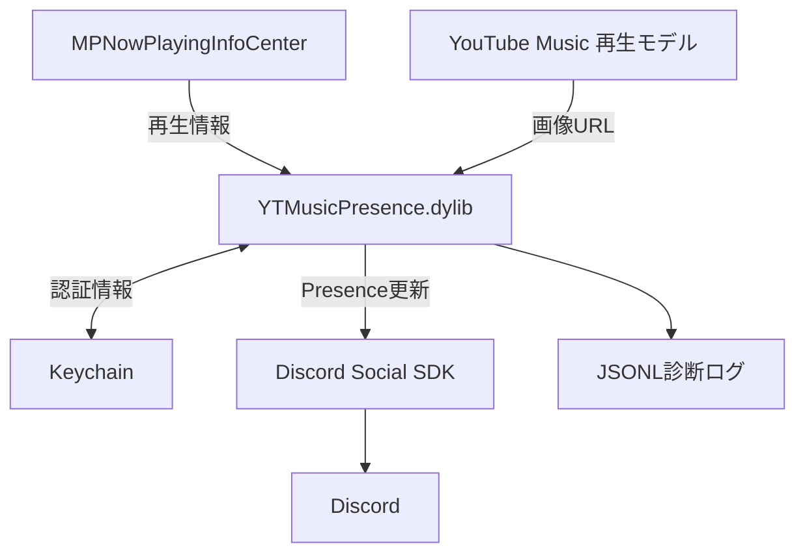

  
> [!IMPORTANT]
> 個人的にOpenAi GPT-6.1 Solで遊んだ成果物です。安全性は知りません。
<p align="center">
  
</p>

<h1 align="center">YTMusic iOS DiscordRPC</h1>
<p align="center">
iOS版YouTube Musicの再生情報をDiscord Social SDK経由でRich Presenceへ送信するObjective-C++ dylib。<br>
<a href="https://github.com/dayanch96/YTMusicUltimate">YoutubeMusicUltimate</a> を一部参考に作成されました。
</p>
## pictures


## Features

- `MPNowPlayingInfoCenter`から曲名・アーティスト・アルバム・再生時刻を取得。送信間隔は最低15秒で、一時停止・停止時にPresenceを消去。
- OAuth + PKCEで認証し、アクセストークンとリフレッシュトークンをKeychainに保存。
- 再生モデルからサムネイルURLを取得。画像を含む送信が拒否された場合は画像なしで再試行。
- 認証・接続・送信結果をJSON Lines形式で記録。認証情報の伏せ字とログローテーションに対応。
- PythonでMach-Oのロード命令を追加し、既存dylibのSHA-256とZIPのCRCを検証して未署名IPAを生成。

## Requirements

| 対象 | 要件 |
| --- | --- |
| ビルド環境 | macOS、Xcode、iPhoneOS SDK、`xcrun` |
| 言語 | Objective-C / Objective-C++、C++20、Python 3.10以上 |
| Discord SDK | 公式`discord_partner_sdk.xcframework`のiOS実機arm64スライス |
| 入力IPA | Bundle IDが`com.google.ios.youtubemusic`、実行ファイルが非暗号化のthin arm64 |
| 実行環境 | iOS 16.0以上 |
| 署名環境 | アプリと全ネストコードの再署名・インストールに対応するツール |
| Discord認証 | Social SDKを利用できるApplication ID、Public Client設定、OAuthリダイレクトURI |

- 既存の検証記録ではYouTube Music **9.26.2**とDiscord Social SDK **1.10.19337**を使用。
- Pythonツールは標準ライブラリのみを使用。
- YouTube Music本体、Discord SDK、署名用証明書は同梱しません。
- Windowsでは`tools/build.py`によるコンパイルは実行できません。

## Installation

以下のコマンドはリポジトリのルートで実行します。

### 1. ビルド入力を配置

```sh
mkdir -p work/input

python3 --version
xcrun --sdk iphoneos --show-sdk-path
xcrun --sdk iphoneos clang++ --version
```

公式SDKと入力IPAを以下の構成で配置します。

```text
work/input/
├── discord_partner_sdk.xcframework/
└── YouTubeMusic_9.26.2.ipa
```

### 2. Discord認証を設定

1. 使用するDiscordアプリでSocial SDKを有効にする。
2. OAuth2設定でPublic Clientを有効にする。
3. `config.json`の`application_id`をそのアプリのIDに変更する。
4. リダイレクトURIに`discord-<application_id>:/authorize/callback`を登録する。

初期設定のApplication IDを使用する場合のリダイレクトURI：

```text
discord-1559887091171852310:/authorize/callback
```

Client Secretは使用しません。認証スコープはSDKの`GetDefaultPresenceScopes()`で指定します。

### 3. ビルド設定を確認

`config.json`：

```json
{
  "application_id": "1559887091171852310",
  "minimum_ios": "16.0",
  "asset_key": "ytmusic",
  "use_assets": false,
  "use_cover": true
}
```

| 設定 | 用途 |
| --- | --- |
| `application_id` | 認証・Presence送信に使用するDiscord Application ID |
| `minimum_ios` | dylibのiOS Deployment Target |
| `asset_key` | 静的アセットとして使用する登録済み画像のキー |
| `use_assets` | 動的サムネイルを取得できない場合に静的アセットを使用 |
| `use_cover` | サムネイル表示の初期値。アプリ内で変更可能 |

設定ファイルの変更後は再ビルドが必要です。静的アセットの登録は`use_assets: true`の場合に必要です。

### 4. ビルドとIPA生成

```sh
python3 tools/build.py \
  --sdk ./work/input/discord_partner_sdk.xcframework \
  --ipa ./work/input/YouTubeMusic_9.26.2.ipa \
  --out ./build/YouTubeMusic_9.26.2_Presence_unsigned.ipa
```

生成物：

```text
build/
├── Config.h
├── YTMusicPresence.dylib
├── YouTubeMusic_9.26.2_Presence_unsigned.ipa
└── YouTubeMusic_9.26.2_Presence_unsigned.report.json
```

- 入力IPAは上書きしません。出力IPAが存在する場合もエラーで終了します。
- 暗号化された実行ファイル、未対応のMach-O形式、ロード命令用のヘッダ余白不足はエラーになります。
- 生成IPAは未署名です。メインアプリ、追加dylib、SDKフレームワークを含む全ネストコードを再署名してからインストールしてください。
- 署名・インストール処理は本リポジトリに含まれません。

## Usage

1. YouTube Musicのアカウントメニューから「Discord Rich Presence」を開く。
2. 「Discordと連携 / 再連携」を選択し、OAuth認証を完了する。
3. 曲を再生し、Discordのアクティビティ表示を確認する。

| 操作 | 動作 |
| --- | --- |
| 共有を停止 | Presenceを消去してSDK接続を切断 |
| 共有を再開 | 共有と送信の再試行を再開 |
| サムネイルを非表示 / 表示 | 曲画像の送信を切り替え |
| 診断ログを共有 | ログファイルを書き出し |
| 連携を解除 | ローカル認証情報を削除し、トークン失効を要求 |

dylibのみをビルドする場合：

```sh
python3 tools/build.py \
  --sdk ./work/input/discord_partner_sdk.xcframework
```

### Diagnostics

ログはアプリ内の以下のパスに保存します。

```text
Documents/YTMusicPresence/
├── presence.jsonl
└── presence.previous.jsonl
```

- 起動、認証、トークン更新、SDK接続状態、Presence送信結果を記録。
- 送信失敗時はSDKエラー、HTTPステータス、Discordエラーコード、レスポンスを記録。
- OAuthトークン、認証コード、PKCE verifierを伏せ字化。
- 曲名・アーティスト・画像URLを含む。
- 約1 MiBでローテーションし、直近2ファイルを保持。

## Architecture

再生情報の送信経路：
`YouTube Music → MPNowPlayingInfoCenter → YTMusicPresence.dylib → Discord Social SDK → Discord`



- Objective-C++：再生情報の取得、設定UI、OAuth認証、Presence送信。
- Python：dylibのビルドとIPAへの組み込み。iOS上では実行しません。
- 実行時はiPhoneからDiscordへ直接接続。
- SDK呼び出し、コールバック、状態変更はメインスレッドで処理。
- 設定UIと画像取得はYouTube Musicの非公開クラスに依存。

IPAへの組み込み時は以下を実行します。

- `@rpath/YTMusicPresence.dylib`のロード命令を追加。
- 必要に応じて`@executable_path/Frameworks`のRPATHを追加。
- dylibとDiscord SDKフレームワークを`Frameworks`へ配置。
- OAuth用URLスキーム、Discord照会スキーム、ファイル共有設定を`Info.plist`へ追加。
- 古い署名リソースとメインアプリのprovisioning profileを除去。
- 既存dylibの保持とZIPの整合性を検証し、レポートを出力。

### Project Structure

```text
.
├── .github/workflows/build-ios.yml  # macOSでのテスト・ビルド・IPA生成
├── config.json                     # Application ID・iOS下限・画像設定
├── src/
│   ├── Presence.mm                 # フック・設定UI・OAuth・Presence制御
│   ├── Artwork.h
│   ├── Artwork.mm                  # 曲画像URLの解決・検証
│   ├── Logger.h
│   └── Logger.mm                   # JSONL保存・伏せ字・ローテーション
├── tools/
│   ├── build.py                    # clang++によるarm64 dylibビルド
│   ├── macho.py                    # Mach-O解析・ロード命令追加
│   └── package_ipa.py              # IPA組み込み・整合性検証
├── tests/
│   ├── artwork_test.mm
│   ├── logger_test.mm
│   ├── test_macho.py
│   └── test_package.py
└── LICENSE
```

## Tests

Mach-O加工とIPA生成のテスト：

```sh
python3 -m unittest discover -s tests -v
```

ログ保存と画像URL解決のネイティブテストはmacOSで実行します。

```sh
mkdir -p build

clang++ -std=c++20 -fobjc-arc -DYTMP_LOG_TESTING \
  -framework Foundation \
  src/Logger.mm tests/logger_test.mm \
  -o build/logger-test

./build/logger-test

clang++ -std=c++20 -fobjc-arc -DYTMP_LOG_TESTING \
  -framework Foundation \
  src/Artwork.mm src/Logger.mm tests/artwork_test.mm \
  -o build/artwork-test

./build/artwork-test
```

iOS実機とDiscord間の認証・表示・バックグラウンド動作は、これらのテストの対象外です。

## Limitations

- 設定メニューと画像取得は非公開クラスに依存するため、YouTube Musicの更新で修正が必要になる場合があります。
- 再生状態を判定できない場合は共有しません。
- iOSによるサスペンド・強制終了中は、更新・消去処理を実行できません。
- Casting、広告、ライブ配信など、Now Playing情報が通常の曲再生と異なるケースは実機確認が必要です。
- ビルドとIPA生成の成功は、OAuth復帰・サムネイル表示・バックグラウンド動作を保証しません。
- オフラインなどでトークン失効に失敗した場合は、Discord側の設定から連携を解除してください。

## License

本プロジェクトのソースコードは[GNU GPL v3](LICENSE)で配布します。

YouTube Music本体とDiscord Social SDKには、それぞれのライセンス・利用条件が適用されます。

## Jailbreak向け deb（0.4.1）

GitHub Actions の `Build iOS deb packages` で3形式を同時生成します。

| ファイル末尾 | 環境 | 配置先 |
| --- | --- | --- |
| `~iphoneos-arm.deb` | Rootful | `/Library/MobileSubstrate/DynamicLibraries/` |
| `~iphoneos-arm64.deb` | Rootless | `/var/jb/Library/MobileSubstrate/DynamicLibraries/` |
| `~iphoneos-arm64e.deb` | RootHide | bootstrap内の `/Library/MobileSubstrate/DynamicLibraries/` |

これらはパッケージ環境の識別子です。実行コードは公式SDKが提供するarm64のiOSデバイス用で、32bit対応やarm64e専用コードを意味しません。iOS 16.0以上、YouTube Musicとtweak injection環境が必要です。RootHideではYouTube Musicへの注入を有効にしてください。

SDKはtweak隣接の `YTMusicPresenceResources` に同梱し、`@loader_path` で参照します。固定されたjailbreak rootのパスには依存しません。ビルド後にtweakとSDKへad-hoc署名を行い、Debianの `dpkg-deb` で3種類を展開・検査します。ソースのGPLライセンスとSDKのLicense-Noticesをパッケージに同梱します。

環境に合う1種類だけをインストールしてYouTube Musicを完全終了・再起動してください。**YTMusicPresence組み込み済みIPAとdebを同時に使わないでください**（二重フック・SDKの競合を避けるため）。YTMusicUltimateだけを導入した元のIPAは対象です。debにはYouTube Music本体やYTMusicUltimateは含みません。

debはアプリ本体のInfo.plistや署名を変更しません。Documentsへのログ保存とアプリ内のログ共有は利用できますが、FilesアプリでDocumentsを公開する設定はIPAビルド側のみです。OAuth・サムネイル・各jailbreak環境での実機動作は別途確認が必要です。

配置方式の参考: [Theos Rootless](https://theos.dev/docs/rootless)、[RootHide Developer](https://github.com/roothide/Developer)。
